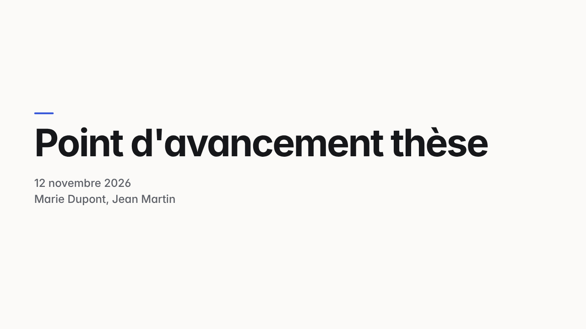
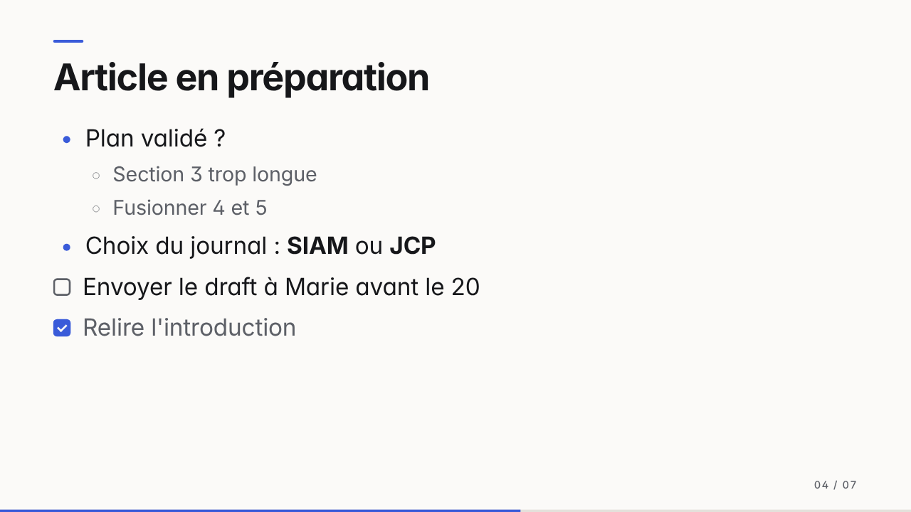

# OnStage

Turn a note into a clean slide deck in a separate window, and **keep editing the note while you present**. Every change appears on the projection as you type.

Any note works: course notes, a talk, a project review, a meeting agenda. Write as usual, present with zero effort, and keep writing in the same note while it is on screen.




## Features

- **Zero syntax.** The note title makes the cover, every `#` heading starts a slide, `---` forces a new slide. Lower headings stay inside the slide. The heading level is a setting (H1, H2, H3 or `---` only).
- **Live projection.** The projection runs in its own window: drag it to the projector or share it in a video call. Edits show up as you type. Only the parts that changed are re-rendered.
- **Follows your cursor.** The projection shows the topic you are writing in. Navigating by hand pauses following until you type in the note or move your cursor to another topic.
- **Calm mode** (default). The line you are typing only appears once you pause or move to the next line, so nobody watches your typos.
- **Text fits automatically.** As a topic grows, its text shrinks gently. When a slide is full, it continues on a slide marked "continued".
- **Generated slides.** A cover (the note title, plus the properties you choose, such as subtitle, author or date) and a table of contents listing the slide titles. Both can be turned off.
- **Markdown on the slide.** Click the Edit button (shown on hover) or press Cmd+E (Ctrl+E) to turn the current slide into its Markdown source and edit it right there. What you type is written to the note as you go. Press Escape or Cmd+E to show the slide again.
- **Autocompletion.** While editing a slide in Markdown, `[[` suggests notes and files of the vault and `#` suggests existing tags.
- **Opens where it should.** With two screens, the projection opens full size on the other screen and the keyboard stays in your note. With one screen, it opens in front.
- **Links.** Web links open in your browser; links to notes open in a tab of the main window, never on the projection. Clicking a link never changes slide.
- **Fills the screen.** The slide takes the shape of the window or screen (4:3 to 21:9), with no empty bands in fullscreen. Zoom with + and -. Can be turned off.
- **Images without extra syntax.** An image alone on a slide fills it; images that follow each other in the note form a row; `![[image.png|400]]` keeps the width you chose in the note.
- **Everything Obsidian renders.** Images, embeds, LaTeX math, callouts, code with syntax highlighting, tables, Mermaid.
- **Presentation remotes.** Page Up / Page Down change slides even while the cursor is in the editor.
- **Light and dark themes**, accent color and font settings. High contrast for projectors.

OnStage only writes to your note when you edit a slide in Markdown, and checks first that the note has not changed in the meantime. Undo works as usual in the note. Editing on the slide can be turned off in the settings.

## Usage

1. Open a note and run **Present current note** (command palette or ribbon icon).
2. With two screens, the projection opens on the other one; otherwise move it there. Click it and press `F` for fullscreen.
3. Keep writing in your note.

### Example note

Saved as `Numerical schemes.md`, this note gives a cover with that title, the author and the date, a table of contents and three slides.

```markdown
---
author: Marie Dupont
date: 2026-11-12
---
# Why another scheme?
- Convergence proven for $\alpha < 1$
- New error bound:

$$
\| u - u_h \|_{L^2} \le C\, h^2 \, \| u \|_{H^2}
$$

# Results
![[figure.png]]

# Open questions
```

### Keys in the projection window

| Key | Action |
|---|---|
| Right, Down, Page Down, Space, click | Next slide |
| Left, Up, Page Up, Backspace, click on the left third | Previous slide |
| Home / End | First / last slide |
| F | Fullscreen |
| Cmd+E / Ctrl+E, Edit button | Edit the slide as Markdown, and back to the slide |
| + / - / 0 | Zoom in, zoom out, reset zoom |
| Escape | While editing: back to the slide (changes are saved) |
| B or . | Black screen |

### Commands

All commands can be bound to hotkeys in Settings, Hotkeys. No hotkey is set by default.

- Present current note
- Stop presenting
- Next slide / Previous slide
- Toggle follow cursor
- Push pending changes to the projection (manual mode)
- Toggle Markdown editing of the current slide
- Toggle black screen
- Toggle projection fullscreen

The status bar shows the current slide and whether the projection follows the note. Click it to pause or resume following.

## Settings

| Setting | Default |
|---|---|
| Heading level that starts a slide | H1 (H2, H3 or "--- only" available) |
| Cover and table of contents slides | On, on |
| Update mode | Calm (also Direct and Manual) |
| Follow cursor | On |
| Markdown editing on the slide | On |
| Capture Page Up / Page Down in the editor | On |
| Theme | Light |
| Minimum text size before splitting | 70% |

## Notes

- Desktop only: Obsidian does not support separate windows on mobile.
- Each block of a slide is rendered separately, so reference-style links and footnotes that point to another block are not resolved.
- If your projector mirrors your screen instead of extending it, the audience sees your editor. OnStage warns you when it detects a single screen.

## Development

```sh
npm install
npm run dev      # watch build
npm run build    # type-check and production build
npm test         # parser tests
npm run lint     # Obsidian review rules
```

Copy `main.js`, `manifest.json` and `styles.css` into `<vault>/.obsidian/plugins/onstage/` to test.

To release: `npm version patch` (updates `manifest.json` and `versions.json`), then push `main`. The workflow publishes the GitHub release for any new version.

---

## En français

OnStage transforme une note en diaporama dans une fenêtre séparée, et tu continues à modifier la note pendant la présentation : les changements apparaissent en direct. Le bouton Modifier ou Cmd+E dans la projection transforme aussi la diapo en Markdown modifiable sur place. Ça marche avec n'importe quelle note : cours, exposé, revue de projet, réunion. L'interface est disponible en français.

## License

MIT
